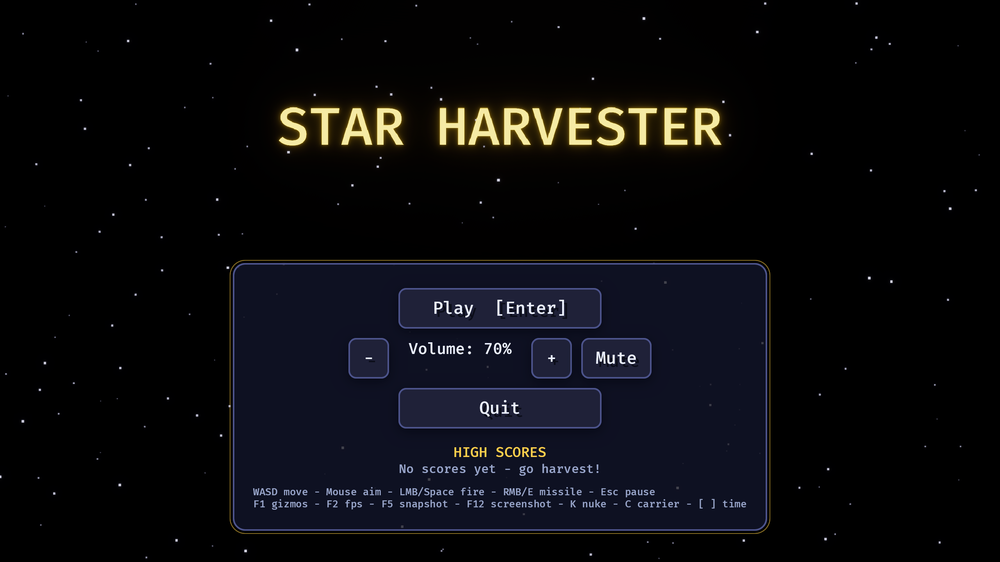
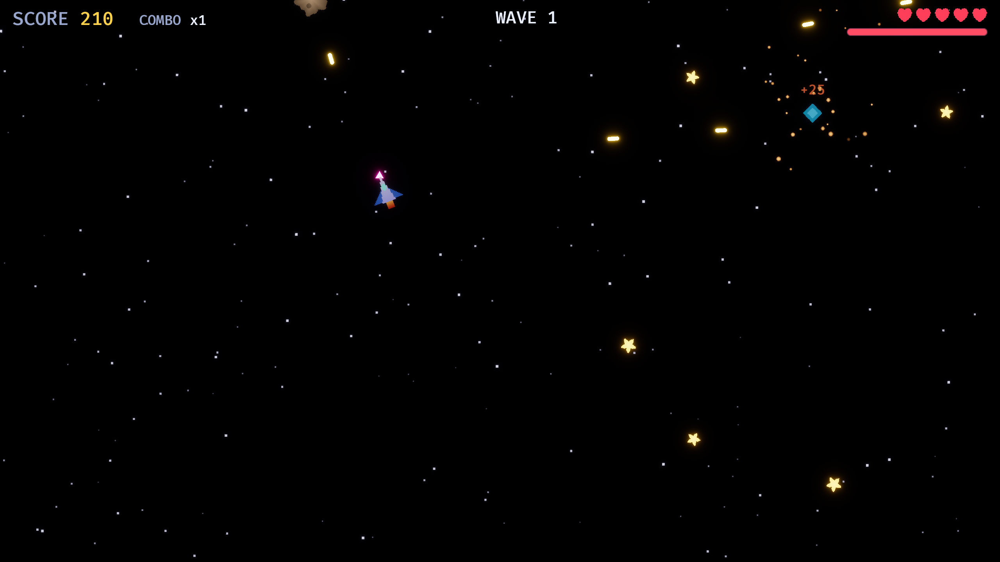

# bevy_demo01 · Star Harvester

> 用 **Bevy 0.19.1**（Rust 1.95+）写的 2D 太空射击 + 收集小游戏，目标是 **尽可能多地覆盖 Bevy API**，
> 并且做到：逻辑可无头测试、确定性可复现、脚本化构建/测试/打包。

| 维度 | 数据 |
|---|---|
| 源码 | `src/` 27 个文件约 5.8k 行（含单元测试）+ `tests/` 约 1k 行 |
| 测试 | **130 个**（92 单元 + 38 集成），全部无头运行，≈3s |
| API 覆盖 | ECS / 状态机 / Message / Observer / 关系 / 钩子 / 资源管线 / UI / 文字 / 音频 / 输入 / Gizmos / 拾取 / 动画 / 相机 / 后处理 / 诊断 / 反射 / 异步任务 …，见 [docs/API_COVERAGE.md](docs/API_COVERAGE.md) |
| 资源 | 纯标准库 Python 生成 PNG/WAV + 运行时 CPU 程序化贴图，零外部素材 |

| 菜单（Text2d 关键帧动画 + Bloom、渐变面板） | 游戏内（HUD、精灵表动画、Mesh2d 子弹、粒子、飘字） |
|---|---|
|  |  |

> 两张图都由 `./scripts/smoke_window.sh` 自动驾驶截取。

## 快速开始

```bash
cd bevy_demo01
./scripts/setup.sh        # 自检 rustc>=1.95、生成 assets、预编译（首次 10~30 分钟）
./scripts/run.sh          # 开玩
./scripts/test.sh         # 130 个测试
```

`make help` 查看全部入口（`make run / test / lint / sim / smoke / release / ci`）。

## 玩法与操作

驾驶飞船收集 ★ 星星（连击倍率最高 x5），击落 **陨石**（卷绕、互相弹开）、**猎手**（追踪你）、
**母舰**（带 4 块装甲子实体，伤害先打装甲再冒泡到本体）。每 25 秒升一波，敌人更多更快。
敌人掉落道具：🛡 护盾（吸收一次伤害）、⚡ 连射、❤ 回血。

| 按键 | 作用 | 按键 | 作用 |
|---|---|---|---|
| WASD / 方向键 / 左摇杆 | 移动 | 鼠标 / 右摇杆 | 瞄准（右摇杆推动即开火） |
| 左键 / Space / RT | 射击 | 右键 / E / RB | 追踪导弹（点击敌人可锁定目标） |
| Esc / P / Start | 暂停 | Enter | 开始 / 重开 |
| M | 静音 | F1 | 调试 Gizmos（碰撞体/速度/追踪线） |
| F2 | FPS 覆盖层 + 帧时间图 | F5 | 反射快照玩家组件 → `saves/snapshot.ron` |
| F12 | 截图 → `screenshots/` | `[` `]` `\` | 时间减速 / 加速 / 复位 |
| K | 作弊：清屏（一次性系统） | C / H | 作弊：刷母舰 / 满血 |

## 目录结构

```text
bevy_demo01/
├── Cargo.toml              # 只开 2d+ui+audio+wav+dev_tools 特性；依赖 opt-level=3
├── assets/
│   ├── config/game.cfg.ron # 数值配置（自定义 AssetLoader，支持热重载）
│   ├── textures/           # ship_sheet.png(4 帧精灵表) star.png   ← gen_assets.py 生成
│   └── audio/              # collect.wav music.wav                   ← gen_assets.py 生成
├── src/
│   ├── lib.rs              # 插件分层：GameLogicPlugin / GameUiPlugin / PresentationPlugin
│   ├── main.rs             # DefaultPlugins 定制 + GamePlugin
│   ├── bin/headless_sim.rs # 无头模拟器（CI / 数值平衡）
│   ├── state.rs schedule.rs events.rs components.rs config.rs input.rs
│   ├── player.rs enemy.rs combat.rs collectibles.rs score.rs effects.rs save.rs
│   ├── assets.rs camera.rs audio.rs visuals.rs debug.rs autoplay.rs math.rs rng.rs
│   └── ui/{mod,widgets,screens,hud}.rs
├── tests/                  # 集成测试（无头 App）
│   ├── common/mod.rs smoke.rs state_flow.rs combat.rs ecs_features.rs assets_config.rs
├── scripts/                # setup run test lint sim smoke_window release ci gen_assets.py
└── docs/                   # ARCHITECTURE / API_COVERAGE / TESTING / PITFALLS
```

## 脚本

| 脚本 | 作用 |
|---|---|
| `scripts/setup.sh` | 检查 rustc 版本、生成资源、`cargo build --all-targets` |
| `scripts/run.sh [--release\|--hot\|--autoplay]` | 运行；`--hot` 开启 `file_watcher` 热重载；`--autoplay` AI 演示 |
| `scripts/test.sh [filter] [--repeat N]` | 全部测试，可重复 N 轮抓不稳定用例 |
| `scripts/lint.sh [--fix]` | `cargo fmt --check` + `clippy -D warnings` |
| `scripts/sim.sh [seeds] [frames]` | 多 seed 无头模拟，输出 JSON 行 |
| `scripts/smoke_window.sh` | 真窗口 + AI 驾驶 + 自动截图 + 亮度校验 |
| `scripts/release.sh` | release 构建并打包 `dist/*.tar.gz` |
| `scripts/ci.sh` | assets → lint → test → sim 一条龙 |
| `scripts/gen_assets.py [--check\|--luma PNG]` | 生成 / 校验资源；计算截图平均亮度 |

## 环境变量

| 变量 | 作用 |
|---|---|
| `BEVY_DEMO_AUTOPLAY=1` / `menu` | AI 自动驾驶（`menu` = 停在菜单） |
| `BEVY_DEMO_EXIT_AFTER=N` | N 秒后自动退出 |
| `BEVY_DEMO_SCREENSHOT_AT=N` | 第 N 秒自动截图 |
| `BEVY_DEMO_SAVE_DIR=path` | 存档目录（默认 `./saves`） |
| `BEVY_ASSET_ROOT=path` | Bevy 原生：资源根目录 |

## 文档

- [docs/ARCHITECTURE.md](docs/ARCHITECTURE.md) —— 插件分层、调度阶段、状态机、伤害冒泡、对象池（Mermaid 图）
- [docs/API_COVERAGE.md](docs/API_COVERAGE.md) —— Bevy API → 代码位置 → 对应测试 的索引表
- [docs/TESTING.md](docs/TESTING.md) —— 无头测试方法论与技巧
- [docs/PITFALLS.md](docs/PITFALLS.md) —— Bevy 0.19 迁移要点与本项目踩过的坑

## 常见问题

- **首次编译很慢**：Bevy 依赖树 ~550 个 crate，`[profile.dev.package."*"] opt-level=3` 让依赖一次编好、之后增量只编自己的代码（几十秒）。
- **直接运行 `target/release/bevy_demo01` 找不到资源**：在项目根目录运行，或设置 `BEVY_ASSET_ROOT`；`release.sh` 打的包已把 `assets/` 放在可执行文件旁。
- **Linux 编译失败**：安装 `libasound2-dev libudev-dev libwayland-dev libxkbcommon-dev`。
- **窗口冒烟截图全黑**：macOS 在锁屏/显示器休眠/窗口被遮挡时不合成窗口内容，保持屏幕唤醒后重试。
