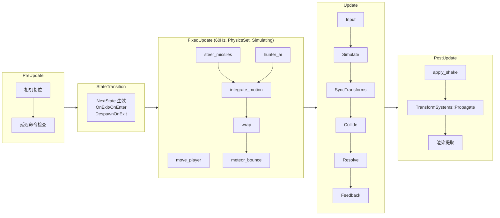
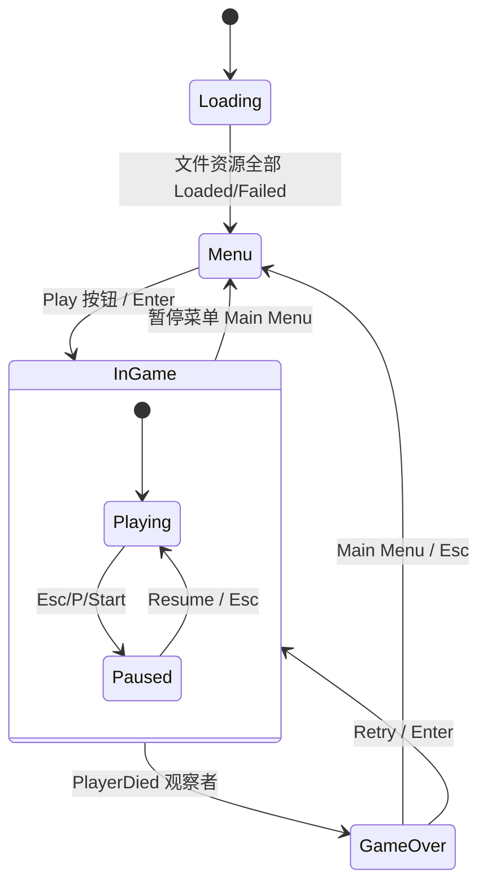
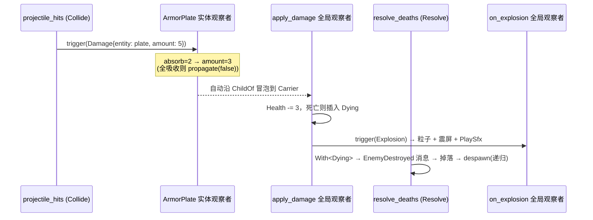
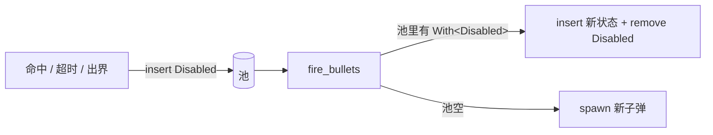

# 架构

## 1. 插件分层：逻辑 / UI / 表现 三层解耦

核心原则：**逻辑层只读写组件与资源，绝不触碰渲染/音频设备**。于是整个游戏逻辑可以在
`MinimalPlugins` 下无头运行 —— 130 个测试全部基于这一点。

```mermaid
graph TD
    main["main.rs<br/>DefaultPlugins.set(Window/Image/Asset/Log)"] --> GP[GamePlugin]
    GP --> GLP[GameLogicPlugin<br/>无头可测]
    GP --> GUI[GameUiPlugin<br/>无头可测]
    GP --> PP[PresentationPlugin<br/>需要渲染器]
    GP --> AP[AutoplayPlugin<br/>env 驱动]

    GLP --> S[StatePlugin] & SC[SchedulePlugin] & EV[EventsPlugin] & CL[ConfigLogicPlugin]
    GLP --> IN[GameInputPlugin] & PL[PlayerPlugin] & EN[EnemyPlugin] & CB[CombatPlugin]
    GLP --> CO[CollectiblesPlugin] & SCO[ScorePlugin] & EF[EffectsPlugin] & SV[SavePlugin]
    GLP --> AL[AudioLogicPlugin] & DL[DebugLogicPlugin]

    GUI --> HUD[HudPlugin] & SCR[screens: Loading/Menu/Pause/GameOver]

    PP --> CA[ConfigAssetPlugin<br/>AssetLoader] & AS[AssetLoadingPlugin]
    PP --> CAM[GameCameraPlugin<br/>Bloom/Tonemap/Shake] & AU[AudioPresentationPlugin]
    PP --> VI[VisualsPlugin<br/>星空/AnimationClip] & DP[DebugPresentationPlugin<br/>Gizmos/FPS/截图/诊断]

    T["tests/*.rs + headless_sim"] -. headless_app() .-> GLP
    T -.-> GUI
```

| 依赖方向 | 约定 |
|---|---|
| 逻辑 → 资源句柄 | 只通过 `Res<GameAssets>` 拿 `Handle`；测试里 `GameAssets::default()` 全是默认句柄 |
| 逻辑 → 音频 | 只写 `PlaySfx` 消息，`AudioPresentationPlugin` 决定怎么播 |
| 逻辑 → 相机 | 只写 `CameraTrauma` 资源，`GameCameraPlugin` 负责震动 |
| 逻辑 → 配置 | 只读 `Res<GameConfig>`；`ConfigAssetPlugin` 负责把磁盘文件同步进来 |
| 输入 → 逻辑 | 设备 → `PlayerIntent`；`IntentSource::Scripted` 时由测试/AI 直接写 |

## 2. 每帧调度

- `Input` 在 `AppState::InGame` 运行（暂停时也要能按 Esc 恢复）。
- `Simulate..Resolve` 只在计算状态 `Simulating`（= InGame ∧ Playing）存在时运行。
- **`SyncTransforms`**：在碰撞前手动再跑一次官方变换传播系统，避免新生成/复用实体的
  `GlobalTransform` 停留在原点造成“幽灵碰撞”（详见 PITFALLS #6）。
- 所有写 `GameRng` 的系统显式排序（`spawn_stars.after(spawn_enemies)`），保证同 seed 可复现。

## 3. 状态机

| 类型 | 名称 | 规则 |
|---|---|---|
| `States` | `AppState` | 顶层 |
| `SubStates` | `GamePhase` | `#[source(AppState = AppState::InGame)]`，离开游戏自动消失 |
| `ComputedStates` | `Simulating` | 源：`GamePhase`，仅 `Playing` 时存在 |
| `ComputedStates` | `ShowHud` | 多源：`(AppState, Option<GamePhase>)` |

进入 `Paused` 时 `Time<Virtual>::pause()`，`FixedUpdate` 因此自然停摆；离开时恢复。

## 4. 伤害结算：碰撞 → 事件冒泡 → 观察者

- 装甲片是母舰的子实体（`with_children` + `.observe(armor_absorb)`），碰撞读 `GlobalTransform`。
- `Damage` 是 `#[entity_event(propagate, auto_propagate)]` 的 `EntityEvent`。
- 死亡不在观察者里直接 despawn，而是打 `Dying` 标记（SparseSet）→ 统一结算，避免同帧重复计分。

## 5. 子弹对象池：`Disabled`

- 被 `Disabled` 的实体默认对**所有查询隐身**（物理、碰撞、渲染都看不到）；
  需要时用 `With<Disabled>` 或 `Allow<Disabled>` 显式包含。
- 实测：60 秒持续射击 301 发子弹只创建了 8 个实体。
- `DespawnOnExit` 内部用 `Allow<Disabled>`，所以离开游戏时池也会被清掉。

## 6. 关系（Relationship）

`Targeting(Entity)` ↔ `TargetedBy(Vec<Entity>)`：
- 猎手 → 玩家、导弹 → 敌人共用同一关系。
- 目标被销毁时 Bevy 自动移除所有源实体上的 `Targeting` → 导弹直飞、猎手停止追踪，无需手动清理。
- Gizmos 调试层（F1）会把所有追踪关系画成品红色连线。

## 7. 资源管线

```mermaid
flowchart LR
    GA[gen_assets.py<br/>纯标准库] -->|PNG/WAV| FS[(assets/)]
    FS -->|AssetServer::load| L[Loading 状态<br/>track_loading]
    CPU[assets.rs paint&#40;&#41;<br/>Image::new_fill + set_color_at] -->|Assets&lt;Image&gt;::add| GAR[GameAssets 资源]
    L --> GAR
    CFG[game.cfg.ron] -->|GameConfigLoader| AC[Assets&lt;GameConfig&gt;]
    AC -->|AssetEvent LoadedWithDependencies / Modified| RC[Res&lt;GameConfig&gt;]
    RC -->|resource_changed| FX[Time&lt;Fixed&gt; 步长等]
```

